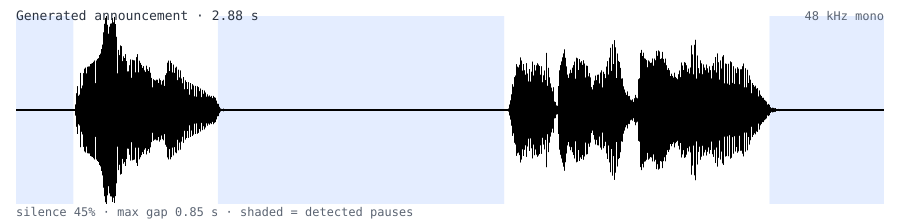

# 小米 MIMO-TTS 批量抽卡脚本

用 MiMo-V2.5-TTS 语音克隆模型批量生成配音，逐条"抽卡"直到质量达标。

版本 1.0.0

---

## 效果展示

下面是脚本自己生成的一条音频的波形图，浅蓝阴影是它识别出的停顿：



> 这张图正好说明"抽卡"的判据：句子之间要停得住，词与词之间不要拖。
> 静音占比、最长停顿、语速三项指标就是从这个分析里算出来的，任何一项不达标就重抽。

## 1. 概述

**定位**：小米 MIMO-TTS（MiMo-V2.5 语音克隆）的批量抽卡脚本。
适合游戏配音、语音包、播报台词这类"文本量大、要求稳定、逐条过检"的场景。

把一份台词表（纯文本，一行一条）批量合成为语音。每一条都按**抽卡**的方式处理：
抽一次，检测这一张是否达标；不达标就再抽一次，直到达标或用尽次数。

一次完整运行：

1. 读取文本，每行作为一条待合成台词；
2. 在真实句末标点后插入停顿标记 `[]`，让模型在句子之间停住；
3. 调用语音克隆接口**抽一次**音频；
4. 检测这一张是否**拖沓**（静音多、停顿长、语速慢、时长异常）；
5. 达标即落盘；不达标则重抽，默认最多 5 次；
6. 次数用尽仍不达标则**丢弃不保存**，计入失败清单，重跑时会再抽；
7. 全部结果写入 `logs/` 下的日志与 Markdown 报告。

```mermaid
flowchart LR
    A[txt 一行一条] --> B[句末标点后插 []]
    B --> C[调接口抽一次]
    C --> D{拖沓检测}
    D -- 达标 --> E[写入 output/时间戳/]
    D -- 不达标 --> F{还有重抽次数?}
    F -- 有 --> C
    F -- 没有 --> G[丢弃 + 记 FAIL]
    E --> H[logs: run.log + report.md]
    G --> H
```

脚本**不对音频做任何后期处理**（不剪静音、不变速、不加滤镜），接口返回什么就保存什么，
质量完全靠"抽到合格的为止"来保证。

## 2. 运行环境

| 项目 | 要求 |
| --- | --- |
| 操作系统 | Windows / macOS / Linux |
| Python | 3.9 及以上（使用了内置泛型注解） |
| 网络 | 可访问接口地址 |
| 外部程序 | 无（不需要 ffmpeg） |

## 3. 安装与初始化

### 3.1 安装依赖

```bash
py -m pip install -r requirements.txt
```

### 3.2 配置密钥

密钥不写在配置文件里。把模板复制成实际文件：

```bash
cp .env.example .env        # Windows: copy .env.example .env
```

编辑 `.env`，填入自己的密钥：

```ini
MIMO_API_KEY=sk-你的密钥
```

密钥优先级：**系统环境变量 > `.env` 文件 > `config.yaml` 的 `api.api_key`**。
临时更换可直接 `set MIMO_API_KEY=sk-xxx`，无需改动任何文件。

> `.env` 已被 `.gitignore` 排除，不会进入版本库。

## 4. 目录结构

```
工程根目录/
├─ main.py              启动脚本
├─ requirements.txt     依赖清单（openai、pyyaml）
├─ config.yaml          全部可调参数
├─ .env                 密钥（不入库）
├─ .env.example         密钥模板
├─ ttsgen/              实现代码
│  ├─ cli.py            命令行入口
│  ├─ config.py         配置读取与校验
│  ├─ text.py           文本读取、条目整理、文件命名
│  ├─ pause.py          停顿标记规则
│  ├─ quality.py        音频统计与拖沓判定
│  ├─ api.py            接口调用与错误处理
│  ├─ ratelimit.py      限速、并发控制、超时
│  ├─ runlog.py         运行日志
│  ├─ runner.py         批处理流程
│  └─ console.py        控制台输出与编码
├─ example.txt          示例文本（入库）
├─ input.txt            实际文本（不入库）
├─ output/              输出根目录（不入库），每次运行一个时间戳子目录
│  └─ 2026_10_25_12_12_45/
│     ├─ 0001_xxx.wav
│     └─ 0002_xxx.wav
└─ logs/                运行记录（不入库）
   ├─ run_2026_10_25_12_12_45.log     TSV 明细
   └─ report_2026_10_25_12_12_45.md   Markdown 报告
```

> 版本库只跟踪程序与示例：所有 `*.txt` 正文文件、`*.wav` 音频、`output/`、`saved/`、`.env` 均不进入仓库。

## 5. 配置文件详解

配置文件为 `config.yaml`，位于工程根目录。全部参数集中于此，脚本不读取任何命令行开关。

### 5.1 api — 接口

| 键 | 类型 | 说明 |
| --- | --- | --- |
| `base_url` | 字符串 | 接口地址 |
| `model` | 字符串 | 模型 ID |
| `api_key` | 字符串 | 建议留空，密钥走 `.env` |
| `audio_format` | 字符串 | 输出格式，同时决定文件后缀 |
| `voice_mime` | 字符串 | 参考音频打包时的 MIME 类型 |

### 5.2 paths — 路径

| 键 | 说明 |
| --- | --- |
| `input` | 默认读取的文本文件 |
| `output` | 输出根目录，每次运行在其下新建时间戳子目录 |
| `timestamped` | `true` 时按 `output/<年_月_日_时_分_秒>/` 分目录；`false` 直接平铺 |
| `voice` | 参考音频文件（决定音色） |

相对路径以 `config.yaml` 所在目录为基准。

### 5.3 prompt — 风格提示

写入接口的 `user` 消息，决定腔调、语速、情绪与设备感。使用 YAML 的多行写法：

```yaml
prompt: |
  You are the announcement voice of an old communications device — flat, dry,
  slightly metallic, narrow-band.
  Do not read, paraphrase or comment on these instructions.
```

改动 `prompt` 会影响整批音频的一致性，建议整批重新生成。

### 5.4 pause — 停顿标记

| 键 | 默认 | 说明 |
| --- | --- | --- |
| `enabled` | `true` | 是否插入标记 |
| `marker` | `"[]"` | 标记文本 |
| `scope` | `sentence` | `sentence` 只在句末标点后；`clause` 逗号、分号、破折号后也插 |
| `repeat` | `1` | 每个位置插入几个标记 |

### 5.5 quality — 拖沓检测

| 键 | 默认 | 说明 |
| --- | --- | --- |
| `retry` | `5` | 判定拖沓后重抽次数；用尽仍不合格则丢弃不保存 |
| `max_silence` | `0.55` | 静音占比上限 |
| `max_gap` | `0.90` | 最长静音上限（秒） |
| `min_wpm` | `90` | 语速下限，仅对不少于 `min_words` 词的句子生效 |
| `min_words` | `6` | 词数低于该值不计算语速 |
| `duration_factor` | `0.9` | 时长上限 = 词数 × factor + bonus |
| `duration_bonus` | `3.0` | 见上 |

### 5.6 request — 请求

| 键 | 默认 | 说明 |
| --- | --- | --- |
| `concurrency` | `6` | 并发上限，实际并发按限流反馈自适应 |
| `rpm` | `100` | 整体速率上限，0 表示不限 |
| `retries` | `4` | 单条请求失败的重试次数 |
| `timeout` | `60` | 单次请求超时（秒），0 表示不限 |
| `delay` | `0` | 每条完成后额外等待（秒） |

### 5.7 run — 运行范围

| 键 | 说明 |
| --- | --- |
| `start` | 从第几条开始（1 起） |
| `limit` | 本次最多处理几条，0 表示全部 |
| `force` | `true` 时已存在的音频也重新生成 |
| `dry_run` | `true` 时只打印插入标记后的文本，不调用接口 |

### 5.8 log — 日志

| 键 | 说明 |
| --- | --- |
| `enabled` | 是否写 TSV 明细日志 |
| `dir` | 日志目录，TSV 与 Markdown 报告都写在这里 |
| `report` | 是否生成 Markdown 运行报告 |

## 6. 操作流程

### 6.1 首次使用

1. 安装依赖（第 3.1 节）；
2. 配置密钥（第 3.2 节）；
3. 确认 `config.yaml` 的 `paths.voice` 指向参考音频；
4. 把台词写入文本文件，一行一条，保存为 UTF-8；
5. 打开预览开关，检查标记位置：

   ```yaml
   run:
     dry_run: true
   ```

   ```bash
   py main.py
   ```

   输出形如：

   ```
   [行 1] Terminal online. [] Systems are ready.
   ```

6. 确认无误后关闭预览：

   ```yaml
   run:
     dry_run: false
   ```

7. 正式运行：

   ```bash
   py main.py
   ```

### 6.2 日常使用

- 处理默认文本：`py main.py`
- 处理指定文本：`py main.py 别的文件.txt`
- 中断后继续：直接再运行一次，已完成的音频自动跳过

### 6.3 分批处理

```yaml
run:
  start: 51
  limit: 50
```

表示处理第 51～100 条。

## 7. 命令行用法

```
py main.py [文本文件]
```

| 形式 | 说明 |
| --- | --- |
| `py main.py` | 使用 `config.yaml` 中 `paths.input` 指定的文件 |
| `py main.py 某文件.txt` | 使用指定文件，其余设置仍取自 `config.yaml` |
| `py -m ttsgen` | 与 `py main.py` 等价 |

- 相对路径先按当前目录查找，找不到再按脚本所在目录查找；
- 不支持 `--xxx` 形式的开关，所有设置均通过 `config.yaml` 调整；误加会提示用法并以退出码 2 结束。

## 8. 输出说明

### 8.1 输出目录

每次运行单独建一个目录，命名格式 `年月日_时分秒`：

```
output/
├─ 2026_10_25_12_12_45/     第一次运行
│  ├─ 0001_xxx.wav
│  └─ 0002_xxx.wav
└─ 2026_10_26_09_30_12/     第二次运行
```

- 同一批次重跑，历史目录里的同名文件仍会被识别并跳过（断点续跑跨目录生效）；
- 整批都被跳过时不会留下空目录；
- 想恢复平铺结构，把 `paths.timestamped` 设为 `false`。

### 8.2 音频文件

命名规则：`<行号>_<正文前 40 字符>.wav`

- 行号为该行在文本文件中的真实行号，不足 4 位前补零；
- 标点、空格替换为下划线，中文字符保留。

示例：

```
output/0001_Terminal_online_Systems_are_ready.wav
```

音频先写入临时文件再改名，中断不会留下不完整文件。

### 8.3 日志文件

位置：`logs/run_<年_月_日_时_分_秒>.log`，与当次输出目录同名，便于一一对应。
制表符分隔，可用 Excel 打开。

| 字段 | 说明 |
| --- | --- |
| `time` | 完成时间 |
| `status` | `OK` 成功 / `FAIL` 失败 |
| `line` | 文本行号 |
| `file` | 输出文件名 |
| `duration` | 音频时长（秒） |
| `silence` | 静音占比 |
| `max_gap` | 最长静音（秒） |
| `wpm` | 语速（词/分） |
| `retries` | 重抽次数 |
| `note` | 失败原因 |

只记录成功与失败；因文件已存在而跳过的条目**不写入日志**。
每次运行独立成文件，因此整批被跳过时不会产生日志文件，历史日志也不会被覆盖。

### 8.4 Markdown 报告

每次运行另生成一份 `logs/report_<时间戳>.md`，用于复盘与归档，内容包含：

| 章节 | 内容 |
| --- | --- |
| 1. 概况 | 开始时间、用时、输入文件、输出目录、日志文件名、模型、停顿标记、风格提示 |
| 2. 结果统计 | 成功 / 跳过 / 失败条数，触发重抽的条目数，重抽总次数 |
| 3. 成功条目 | 逐行列出文件名、时长、静音占比、最长停顿、语速、重抽次数 |
| 4. 失败条目 | 行号、文本片段、失败原因 |
| 5. 本次配置 | 当次使用的检测阈值、并发与限速、超时与重试 |

报告文件名与当次输出目录的时间戳一致，便于一一对应；把 `log.report` 设为 `false` 可关闭。

### 8.5 退出码

| 码 | 含义 |
| --- | --- |
| `0` | 全部成功 |
| `1` | 存在失败条目 |
| `2` | 配置或文件错误 |
| `130` | 被 Ctrl+C 中断 |

## 9. 停顿标记规则

合成结果对句末标点的停顿不稳定，因此在真实句子边界插入 `[]`，让模型明确停住。

判定原则：**ASCII 标点后必须跟空格，才算真正的句子边界**。

| 输入 | 输出 | 原因 |
| --- | --- | --- |
| `Ready. Go` | `Ready.[] Go` | 句点后跟空格，句子边界 |
| `M.E.G. Base` | 不插入 | 词内含点，属缩写 |
| `J. Smith` | 不插入 | 单个大写字母，属姓名首字母 |
| `Mr. Lee`、`e.g. this` | 不插入 | 缩写词表 |
| `Costs 3.5 units` | 不插入 | 句点后是数字 |
| `no space.Here` | 不插入 | 句点后无空格 |
| `"Stop!" Next` | `"Stop!"[] Next` | 跳过收尾引号后是空格，标记置于引号外 |
| `你好。再见` | `你好。[]再见` | 全角标点不要求空格 |
| 行尾的 `.` `!` | 不插入 | 避免尾部多余静音 |

`scope: clause` 时，`,` `;` `:` `—` 按同样规则处理（要求后跟空格），全角 `，、；：` 不要求空格。

## 10. 抽卡机制：拖沓检测与重抽

每条音频落盘前会做一次统计（读取 PCM，10 毫秒一帧，毫秒级耗时），判定这一张是否拖沓：

| 条件 | 依据 |
| --- | --- |
| 时长异常 | 超过 `词数 × duration_factor + duration_bonus` |
| 静音过多 | 静音占比超过 `max_silence` |
| 停顿过长 | 最长静音超过 `max_gap` |
| 语速过慢 | 低于 `min_wpm`（仅对不少于 `min_words` 词的句子） |

命中任一条件即重抽，最多 `retry` 次：

- 中途某次合格，立即保存该次并停止重抽；
- 全部不合格，该条**丢弃不保存**，记录一条 `FAIL`，进程退出码为 1；
- 由于文件未生成，下次运行会重新尝试。

运行日志示例：

```
[3/31] 行 3 太拖沓（时长 5.1s，最长停顿 1.07s，语速 42wpm），第 1 次重抽…
[3/31] 行 3 ok 0003_Terminal_online.wav  2.56s  静音 26%／最长停顿 0.46s／63wpm  重抽 1  (18.2s)
```

> 重抽会产生额外请求。额度紧张时可将 `retry` 调小，或放宽阈值。

## 11. 并发与限速

接口对语音合成模型限制为 **RPM 100 / TPM 10M**，按「账号 + 模型 + 全部密钥合计」计算；此外存在账号级并发上限，超出返回 429。

工具的处理方式：

- 令牌桶按 `rpm` 控制整体速率；
- 并发自 2 起，每成功 5 次加 1 路，遇 429 立即减半并全局冷却，`concurrency` 仅作为上限；
- 429 优先采用响应头 `Retry-After`；
- 仅对 408、429、5xx 及连接类错误重试，其余 4xx 直接判失败。

## 12. 超时与失败处理

- SDK 自带重试已关闭，重试完全由 `retries` 控制，避免叠加导致长时间等待；
- 每次请求另有墙钟超时（`timeout`），到点即放弃等待，1 秒后重发；
- 单条最终失败不生成文件，记录 `FAIL`，不影响其他条目。

最坏耗时约为 `timeout × retries` 每条（默认 60 × 4）。

## 13. 故障排查

| 现象 | 原因与处理 |
| --- | --- |
| `[配置错误] 找不到配置文件` | `config.yaml` 需与 `main.py` 同级 |
| `[配置错误] config.yaml 缺少 xxx` | 配置缺项，按提示补齐 |
| `[错误] 没有可用的 API key` | 根目录缺少 `.env`，或其中 `MIMO_API_KEY` 为空，且未设置环境变量 |
| `[错误] 找不到文本文件` | 路径错误；相对路径先按当前目录、再按脚本目录查找 |
| `[错误] 找不到参考音频` | `paths.voice` 指向的文件不存在 |
| 提示 `429` | 降低 `rpm`（如 10～20）比调整 `concurrency` 更有效 |
| 某条一直失败 | 查看日志 `note` 字段；若为拖沓判定，可先试听同批其他音频，再调整 `quality` 阈值 |
| 标记被念出来 | 用 `dry_run` 核对插入位置；仍被朗读则更换 `marker` 或关闭 `pause.enabled` |
| 中文显示为乱码 | 工具会按终端类型固定编码；重定向检查：`py main.py > out.txt` 后用 UTF-8 编辑器打开 |

## 14. 附录

### 14.1 模块职责

| 文件 | 职责 |
| --- | --- |
| `main.py` | 启动脚本，把工程目录交给 `ttsgen` |
| `ttsgen/cli.py` | 解析命令行、装配配置、返回退出码 |
| `ttsgen/config.py` | 读取 `.env` 与 `config.yaml`，校验并生成配置对象 |
| `ttsgen/text.py` | 文本读取、条目整理、文件名生成 |
| `ttsgen/pause.py` | 停顿标记判定与插入 |
| `ttsgen/quality.py` | 音频统计与拖沓判定 |
| `ttsgen/api.py` | 接口调用、错误分类、退避策略 |
| `ttsgen/ratelimit.py` | 令牌桶、自适应并发、超时调用 |
| `ttsgen/runlog.py` | 日志写入 |
| `ttsgen/runner.py` | 批处理流程与汇总 |
| `ttsgen/console.py` | 控制台编码与线程安全输出 |

### 14.2 常见调整

| 需求 | 修改位置 |
| --- | --- |
| 改变腔调与语速 | `config.yaml` 的 `prompt` |
| 改变停顿判定规则 | `ttsgen/pause.py` |
| 调整检测阈值或重抽次数 | `config.yaml` 的 `quality` |
| 调整并发、限速、超时 | `config.yaml` 的 `request` |
| 新增配置项 | `config.yaml` 与 `ttsgen/config.py` |

## 15. 声明与合规

### 15.1 非官方项目

本项目为个人开源工具，**与小米公司及小米 MiMo 开放平台无任何隶属、合作或背书关系**。
仓库名中的 "MiMo" 仅用于说明调用的是哪一家的接口；接口、模型与商标归其所有者。

### 15.2 接口使用

- 本工具只是按官方接口文档发起常规 HTTPS 请求，未修改、未反编译任何官方组件，也未绕过任何限制；
- 请自行遵守小米 MiMo 开放平台的服务协议与使用规范，包括速率限制、计费与内容政策；
- 生成内容的使用权、商用许可范围以官方协议为准，发布前请自行确认；
- 不要把 API Key 提交到公开仓库；本仓库的 `.env` 已排除在版本控制之外。

### 15.3 声音克隆

参考音频决定了克隆出的音色，请注意：

- 仅使用你有权使用的声音（自己的声音，或已取得明确授权的素材）；
- 未经同意克隆他人声音，可能侵犯其人格权/声音权益，并违反深度合成相关管理规定；
- 对外发布合成音频时，请遵守所在地区关于 AI 生成内容标识的要求。

### 15.4 内容责任

台词文本与生成音频由使用者自行提供与使用，作者不对其合法性、准确性与后果承担责任。

### 15.5 许可

本项目以 [MIT](LICENSE) 许可发布，可自由使用、修改与分发，不提供任何担保。

---
